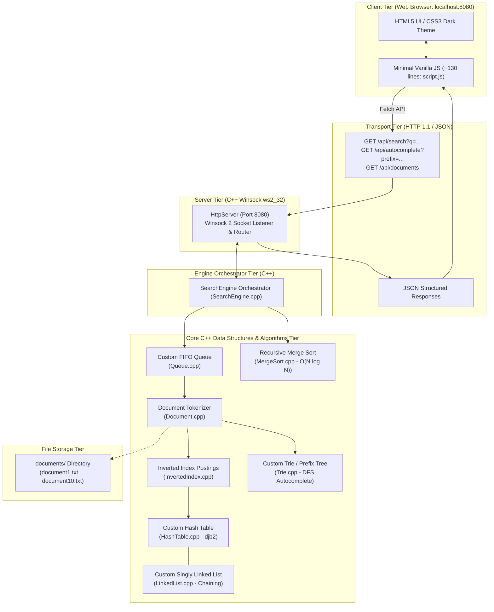
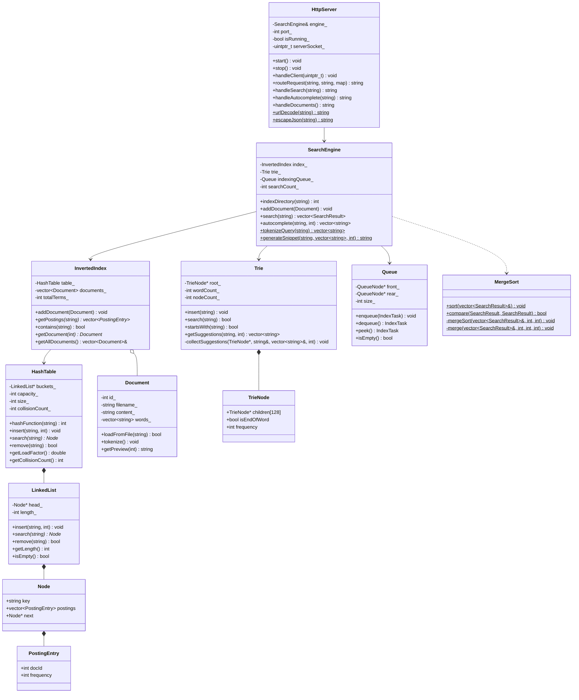
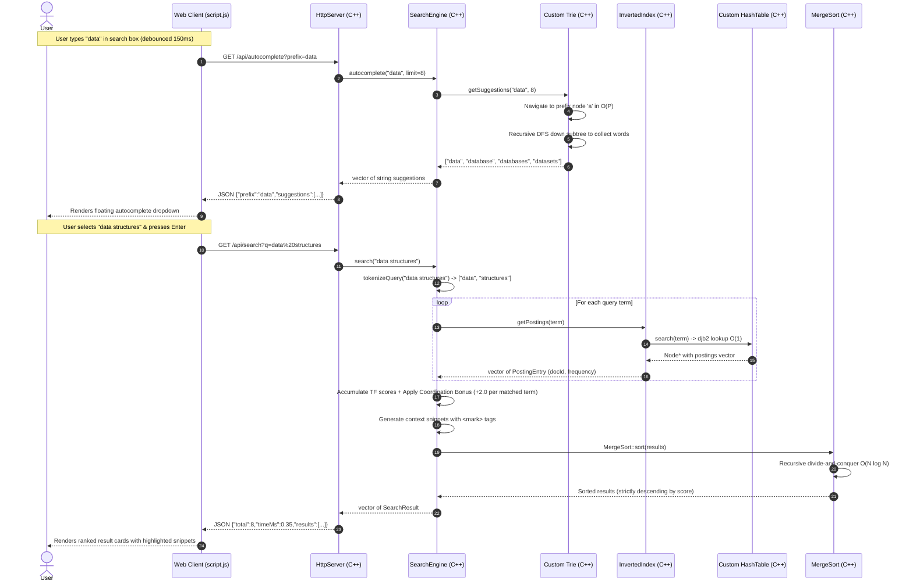

# ⚡ Mini Search Engine — Architectural Report & Technical Documentation
### Complete C++17 Data Structures & Algorithms Core Engine with Minimal Web Frontend

---

## 📑 Table of Contents
1. [Executive Summary & Academic Objective](#1-executive-summary--academic-objective)
2. [End-to-End System Architecture](#2-end-to-end-system-architecture)
   - [2.1 High-Level Architecture Diagram](#21-high-level-architecture-diagram)
   - [2.2 Class & Component Relationship Diagram](#22-class--component-relationship-diagram)
   - [2.3 Execution Flow 1: Document Ingestion Pipeline](#23-execution-flow-1-document-ingestion-pipeline)
   - [2.4 Execution Flow 2: Live Search & Autocomplete Pipeline](#24-execution-flow-2-live-search--autocomplete-pipeline)
3. [The Strict Technology Stack & DSA Boundary](#3-the-strict-technology-stack--dsa-boundary)
4. [Exhaustive Data Structure & Algorithm Deep Dive](#4-exhaustive-data-structure--algorithm-deep-dive)
   - [4.1 Custom FIFO Queue (Document Task Pipeline)](#41-custom-fifo-queue-document-task-pipeline)
   - [4.2 Document Parser & Case-Folding Tokenizer](#42-document-parser--case-folding-tokenizer)
   - [4.3 Custom Singly Linked List (Collision Chaining)](#43-custom-singly-linked-list-collision-chaining)
   - [4.4 Custom Hash Table with djb2 Hashing](#44-custom-hash-table-with-djb2-hashing)
   - [4.5 Inverted Index (Term-to-Document Posting Dictionary)](#45-inverted-index-term-to-document-posting-dictionary)
   - [4.6 Custom Trie / Prefix Tree (DFS Autocomplete Engine)](#46-custom-trie--prefix-tree-dfs-autocomplete-engine)
   - [4.7 Recursive Merge Sort (Stable Multi-Tiered Result Ranking)](#47-recursive-merge-sort-stable-multi-tiered-result-ranking)
   - [4.8 Search Engine Orchestrator & Relevance Scorer](#48-search-engine-orchestrator--relevance-scorer)
5. [Information Retrieval & Relevance Scoring Mathematics](#5-information-retrieval--relevance-scoring-mathematics)
6. [Embedded C++ HTTP Server & Network Architecture](#6-embedded-c-http-server--network-architecture)
7. [REST API Specification](#7-rest-api-specification)
8. [Minimalist Frontend Engineering](#8-minimalist-frontend-engineering)
9. [Project Directory & File Structure](#9-project-directory--file-structure)
10. [Comprehensive Time & Space Complexity Master Reference](#10-comprehensive-time--space-complexity-master-reference)
11. [Compilation, Build & Execution Guide](#11-compilation-build--execution-guide)
12. [Academic Evaluation & DSA Viva Examination Guide](#12-academic-evaluation--dsa-viva-examination-guide)
    - [12.1 Step-by-Step Examiner Demonstration Script](#121-step-by-step-examiner-demonstration-script)
    - [12.2 Comprehensive Viva Q&A with Rigorous Model Answers](#122-comprehensive-viva-qa-with-rigorous-model-answers)

---

## 1. Executive Summary & Academic Objective

The **Mini Search Engine** is a high-performance local text search engine engineered from the ground up in **C++17**, featuring an embedded HTTP server and a responsive, developer-grade **HTML5/CSS3/Vanilla JavaScript** web client.

### Primary Academic Objective
In modern software engineering, high-level libraries (`std::unordered_map`, `std::map`, `std::priority_queue`, `std::sort`, or Lucene/ElasticSearch frameworks) abstract away the underlying mechanics of computer science fundamentals. This project was developed as a rigorous **Data Structures and Algorithms (DSA) capstone** to prove that every core information retrieval component can be implemented **manually in C++**:
- **Zero STL container abstractions** for core algorithms (no `std::unordered_map`, `std::map`, `std::list`, `std::queue`, or `std::sort`).
- **Complete manual memory management** using raw pointers (`new`/`delete`), deterministic destructors, and pointer-relinking mechanics.
- **Strict architectural boundary:** All algorithmic heavy lifting (tokenization, hash table hashing, collision chaining, prefix-tree searching, relevance score summation, and divide-and-conquer sorting) executes inside compiled C++ native binaries. The browser JavaScript layer contains **zero DSA logic**, operating strictly as a lightweight presentation client (~130 lines of code) communicating via JSON over HTTP.

---

## 2. End-to-End System Architecture

### 2.1 High-Level Architecture Diagram



---

### 2.2 Class & Component Relationship Diagram



---

### 2.3 Execution Flow 1: Document Ingestion Pipeline

When the engine starts up, it prepares the search environment through a sequential, memory-safe ingestion pipeline:

```mermaid
sequenceDiagram
    autonumber
    participant Main as main.cpp
    participant SE as SearchEngine
    participant Q as Custom Queue
    participant D as Document
    participant II as InvertedIndex
    participant HT as Custom HashTable
    participant LL as Custom LinkedList
    participant TR as Custom Trie

    Main->>SE: indexDirectory("documents/")
    SE->>Q: Enqueue all .txt files discovered via std::filesystem
    loop While Queue is not empty
        SE->>Q: dequeue() -> IndexTask(docId, filename, filepath)
        SE->>D: loadFromFile(filepath)
        SE->>D: tokenize() (case-fold & strip punctuation)
        SE->>II: addDocument(doc)
        loop For each token in doc.words
            II->>HT: insert(token, docId)
            HT->>HT: djb2 hash = (hash * 33) + c; index = hash % 503
            HT->>LL: buckets[index].insert(token, docId)
            alt Token exists in chain
                LL->>LL: Increment frequency or append PostingEntry
            else Token is new in chain
                LL->>LL: Allocate new Node, insert at head (O(1))
            end
            SE->>TR: insert(token)
            loop For each character in token
                TR->>TR: Navigate or allocate TrieNode(children[ch])
            end
            TR->>TR: Mark isEndOfWord = true, increment frequency
        end
    end
    SE-->>Main: Return totalIndexedCount (10 documents)
```

---

### 2.4 Execution Flow 2: Live Search & Autocomplete Pipeline

When a user interacts with the web interface, requests flow asynchronously between JavaScript and C++:



---

## 3. The Strict Technology Stack & DSA Boundary

| Component | Technology | Strict Policy & Rationale |
|---|---|---|
| **Backend Core** | C++17 | Native compiled performance, direct memory control, zero runtime VM overhead. Full utilization of manual pointers. |
| **Networking** | Windows Sockets 2 (`ws2_32`) | Low-level embedded socket listener. No third-party network libraries (Boost.Beast, cpp-httplib, or libcurl are strictly avoided). |
| **Build System** | CMake 3.15+ & GCC 16.2 | Standard cross-platform build orchestration via MinGW Makefiles. |
| **Frontend UI** | HTML5 & Pure CSS3 | Modern, dark-themed developer dashboard inspired by GitHub and VS Code. **Zero CSS frameworks** (no Bootstrap, Tailwind, or Bulma). |
| **Frontend Client** | Vanilla JavaScript | Minimalist client (~130 lines). **Zero JavaScript frameworks** (no React, Vue, Angular, or Node.js). |

### 🚨 The Non-Negotiable DSA Rule: C++ Owns Everything
This project is an **academic evaluation of data structures**. To prevent any ambiguity during examination:
- **JavaScript NEVER:**
  - Performs any sorting (no `Array.prototype.sort`).
  - Calculates relevance scores or matches keywords.
  - Implements any hashing, tree, or linked structure.
  - Caches or maintains a duplicate copy of the search index.
- **JavaScript ONLY:**
  - Listens for DOM events (`input`, `click`, `keydown`).
  - Calls `fetch('/api/search?q=...')` or `fetch('/api/autocomplete?prefix=...')`.
  - Injects received JSON strings into HTML elements.

---

## 4. Exhaustive Data Structure & Algorithm Deep Dive

---

### 4.1 Custom FIFO Queue (Document Task Pipeline)
* **Header:** `backend/include/Queue.h`
* **Implementation:** `backend/src/Queue.cpp`

#### A. Theoretical Concept
A **Queue** is a linear data structure operating on a **First-In-First-Out (FIFO)** discipline: the earliest element inserted is the earliest element removed. By implementing the Queue using a singly linked list with dedicated `front_` (head) and `rear_` (tail) pointers, both insertion (`enqueue`) and deletion (`dequeue`) execute in strict **$O(1)$ constant time**.

#### B. Node & Memory Representation
```
                    front_                                            rear_
                      │                                                 │
                      ▼                                                 ▼
               ┌─────────────┐       ┌─────────────┐             ┌─────────────┐
               │  IndexTask  │       │  IndexTask  │             │  IndexTask  │
               ├─────────────┤       ├─────────────┤             ├─────────────┤
               │ docId: 0    │       │ docId: 1    │             │ docId: 2    │
               │ filename:...│       │ filename:...│             │ filename:...│
               │ next: ──────┼──────>│ next: ──────┼─── ... ────>│ next: NULL  │
               └─────────────┘       └─────────────┘             └─────────────┘
```

#### C. Role in the Search Engine
The queue orchestrates the ingestion pipeline inside `SearchEngine::indexDirectory()`. Instead of loading files synchronously inside a recursive file iteration loop, the directory discovery stage decouples file discovery from file parsing:
1. `indexDirectory()` discovers `.txt` files on disk.
2. Each file metadata is packaged as an `IndexTask` and enqueued into `indexingQueue_`.
3. The processing loop drains the queue sequentially.

#### D. Why Chosen Over Alternatives
- **Why not `std::vector`?** Dequeuing from an array requires shifting all subsequent $N-1$ elements to the left ($O(N)$ time), or implementing a complex circular buffer with dynamic resizing overhead.
- **Why Linked Queue?** Dynamic node allocation guarantees true $O(1)$ enqueue and dequeue with zero memory waste or buffer resizing stalls.

#### E. Algorithms & Pseudocode
```text
Algorithm Enqueue(task):
    newNode = allocate QueueNode(task)
    if rear == NULL then:
        front = rear = newNode
    else:
        rear.next = newNode
        rear = newNode
    size = size + 1

Algorithm Dequeue():
    if front == NULL then return error (Queue Underflow)
    tempNode = front
    task = tempNode.task
    front = front.next
    if front == NULL then:
        rear = NULL
    delete tempNode
    size = size - 1
    return task
```

#### F. Complexity Analysis
- **Time Complexity:**
  - `enqueue()`: $O(1)$ — Direct pointer update at `rear_`.
  - `dequeue()`: $O(1)$ — Direct pointer update at `front_`.
  - `peek()`: $O(1)$ — Direct read of `front_->task`.
- **Space Complexity:** $O(N)$ where $N$ is the number of pending indexing tasks.

---

### 4.2 Document Parser & Case-Folding Tokenizer
* **Header:** `backend/include/Document.h`
* **Implementation:** `backend/src/Document.cpp`

#### A. Theoretical Concept
Text processing in information retrieval requires converting raw unstructured text files into normalized **tokens** (words). The tokenizer reads character streams, ignores non-alphanumeric punctuation delimiters, and applies **case-folding** (converting uppercase ASCII characters to lowercase: $c \ge \text{'A'} \land c \le \text{'Z'} \implies c + 32$).

#### B. Algorithm & Implementation Details
Tokenization is implemented as an optimal **single-pass $O(N)$ state scanner**:
```cpp
void Document::tokenize() {
    words_.clear();
    string currentWord;
    for (char c : content_) {
        if (isAlphaNum(c)) {
            currentWord += toLower(c); // Accumulate normalized character
        } else {
            if (!currentWord.empty()) {
                words_.push_back(currentWord); // Word boundary reached
                currentWord.clear();
            }
        }
    }
    if (!currentWord.empty()) words_.push_back(currentWord);
}
```
- **Handling Edge Cases:** Hyphenated words (`"object-oriented"`) are split into distinct tokens `["object", "oriented"]`. Trailing words without ending punctuation are captured by the post-loop check.

---

### 4.3 Custom Singly Linked List (Collision Chaining)
* **Header:** `backend/include/LinkedList.h`
* **Implementation:** `backend/src/LinkedList.cpp`

#### A. Theoretical Concept
A **Singly Linked List** is a linear data structure of dynamically allocated nodes connected via forward pointers (`next`). In our architecture, it serves as the **collision resolution engine** (separate chaining) for the Hash Table.

#### B. Node & Memory Representation
```
 head_ 
   │
   ▼
┌─────────────────────────────────┐       ┌─────────────────────────────────┐
│ Node                            │       │ Node                            │
├─────────────────────────────────┤       ├─────────────────────────────────┤
│ key: "programming"              │       │ key: "algorithms"               │
│ postings: [{doc:0,f:10},{doc:3}]│       │ postings: [{doc:2,f:6}]         │
│ next: ──────────────────────────┼──────>│ next: NULL                      │
└─────────────────────────────────┘       └─────────────────────────────────┘
```

#### C. Role in the Search Engine
When multiple words map to the same bucket in the `HashTable`, they form a chain. Each node represents a unique word and stores:
1. `key`: The normalized word string.
2. `postings`: A dynamic vector of `PostingEntry` structs (`{docId, frequency}`).
3. `next`: Pointer to the next collision node in the bucket.

#### D. Memory Leak Prevention
The destructor iterates down the list and reclaims every node:
```cpp
LinkedList::~LinkedList() {
    Node* current = head_;
    while (current != nullptr) {
        Node* toDelete = current;
        current = current->next;
        delete toDelete; // Frees dynamic memory deterministically
    }
    head_ = nullptr;
}
```

#### E. Algorithms & Pseudocode
```text
Algorithm Insert(key, docId):
    existingNode = Search(key)
    if existingNode != NULL then:
        for each posting in existingNode.postings:
            if posting.docId == docId then:
                posting.frequency = posting.frequency + 1
                return
        existingNode.postings.append(PostingEntry(docId, 1))
        return

    // New unique term: Insert at Head (O(1))
    newNode = allocate Node(key)
    newNode.postings.append(PostingEntry(docId, 1))
    newNode.next = head_
    head_ = newNode
    length = length + 1
```

#### F. Complexity Analysis
- **Insert at Head:** $O(1)$ constant time pointer reassignment.
- **Search Key:** $O(L)$ where $L$ is the length of this specific collision chain.
- **Delete Key:** $O(L)$ with pointer relinking via trailing pointer.

---

### 4.4 Custom Hash Table with djb2 Hashing
* **Header:** `backend/include/HashTable.h`
* **Implementation:** `backend/src/HashTable.cpp`

#### A. Theoretical Concept
A **Hash Table** implements an associative array abstract data type that maps keys to values. A hash function transforms a variable-length string key into an integer array index in $O(1)$ average time.

#### B. Hash Function: djb2 (Daniel J. Bernstein)
The engine implements the renowned **djb2 algorithm**, one of the most effective string hashing algorithms known in computer science:
$$\text{hash}_0 = 5381$$
$$\text{hash}_{i} = (\text{hash}_{i-1} \times 33) + c = \left( (\text{hash}_{i-1} \ll 5) + \text{hash}_{i-1} \right) + c$$
$$\text{Bucket Index} = \text{hash} \pmod{\text{Capacity}}$$

#### C. Why 5381, 33, and Prime Table Capacity?
1. **Magic Number 5381:** Bernstein tested thousands of seeds; 5381 provided the lowest collision variance across dictionary words.
2. **Multiplier 33:** 33 provides high bit-dispersion through the bit-shift `(hash << 5) + hash`, ensuring characters at the beginning, middle, and end of words scramble the bits thoroughly.
3. **Prime Capacity ($503$):** If the bucket capacity shares common factors with common character pattern offsets, hash collisions cluster. Modulo division by a prime number guarantees that all buckets across $[0 \dots 502]$ have equal probability of selection.

#### D. Complexity Analysis
- **Average Case:** $O(1)$ time for insertions and lookups.
- **Worst Case:** $O(N)$ if all $N$ distinct words produce identical hash values (mitigated by djb2's dispersion and the 503 prime table size).
- **Load Factor:** $\alpha = \frac{N}{\text{Capacity}} = \frac{713}{503} \approx 1.4175$. Across 503 buckets, 386 buckets are occupied with an average chain length of under 2 nodes!

---

### 4.5 Inverted Index (Term-to-Document Posting Dictionary)
* **Header:** `backend/include/InvertedIndex.h`
* **Implementation:** `backend/src/InvertedIndex.cpp`

#### A. Theoretical Concept
In computer science, a **Forward Index** maps documents to the lists of words they contain:
$$\text{Document } d \longrightarrow [w_1, w_2, w_3, \dots]$$
Finding documents containing `"recursion"` with a forward index requires a brute-force sequential search through all documents: $O(D \times L)$ time ($D$ documents of length $L$).

An **Inverted Index** reverses this mapping:
$$\text{Word } w \longrightarrow \left[ (\text{Doc}_1, \text{TF}_1), (\text{Doc}_3, \text{TF}_3), \dots \right]$$
Querying `"recursion"` immediately returns the exact list of matching documents and their term frequencies in **$O(1)$ average lookup time**.

#### B. Architectural Integration
`InvertedIndex` wraps the custom `HashTable`. When `InvertedIndex::addDocument(doc)` is invoked:
1. It registers `doc` in `documents_` (enabling $O(1)$ metadata and preview lookups by `docId`).
2. For each word in `doc.getWords()`, it calls `table_.insert(word, doc.getId())`.

---

### 4.6 Custom Trie / Prefix Tree (DFS Autocomplete Engine)
* **Header:** `backend/include/Trie.h`
* **Implementation:** `backend/src/Trie.cpp`

#### A. Theoretical Concept
A **Trie (Prefix Tree)** is a multi-way search tree where each node represents a character. All descendants of a node share the common string prefix associated with that node.

#### B. Node Structure & Layout
Each `TrieNode` has an alphabet array of 128 pointers corresponding to standard ASCII:
```cpp
struct TrieNode {
    TrieNode* children[128]; // Direct index mapping: children['a'], children['b']
    bool isEndOfWord;        // True if a valid term terminates here
    int frequency;           // Corpus occurrence counter
};
```

#### C. Autocomplete Algorithm via DFS
```
                 [ROOT]
                   │ 'p'
                 [ 'p' ]
                   │ 'r'
                 [ 'r' ]
                   │ 'o'
                 [ 'o' ]
                   │ 'g'  <── Prefix Node for "prog" (Reached in O(P))
                 [ 'g' ]
                ┌──┴──┐
           'r'  │     │  's'
             ▼       ▼
          [ 'r' ]   [ 's' ]
             │ 'a'     │
          [ 'a' ]   [ 'e' ] ──> isEndOfWord: true ("progse" / "programs")
             │ 'm'
          [ 'm' ] ──> isEndOfWord: true ("program", freq: 2)
```

1. **Phase 1: Prefix Traversal ($O(P)$):**
   Given prefix `"prog"`, traverse `root -> 'p' -> 'r' -> 'o' -> 'g'`. If any pointer is `nullptr`, the prefix does not exist; return immediately.
2. **Phase 2: Subtree DFS Collection ($O(K)$):**
   From the prefix node `'g'`, execute a recursive Depth-First Search traversing non-null child pointers in lexicographical order. When a node with `isEndOfWord == true` is encountered, append the formed word to the suggestion list until reaching `limit = 8`.

#### D. Why Trie Over Hash Table for Autocomplete?
- **Hash Table:** Does not store prefix relationships. Finding words starting with `"prog"` requires scanning all $N$ keys in the dictionary: $O(N \times W)$ time.
- **Trie:** Locates the prefix root in strictly **$O(P)$ time** ($P$ is prefix length, e.g. 4 steps for `"prog"`). The search time is completely **independent of the dictionary size**!

---

### 4.7 Recursive Merge Sort (Stable Multi-Tiered Result Ranking)
* **Header:** `backend/include/MergeSort.h`
* **Implementation:** `backend/src/MergeSort.cpp`

#### A. Theoretical Concept
**Merge Sort** is an optimal, comparison-based sorting algorithm grounded in the **Divide-and-Conquer** paradigm. It recursively bisects the unsorted array until subarrays have a length $\le 1$, and merges sorted halves back together in linear time.

#### B. Multi-Tiered Comparator (`MergeSort::compare`)
Ranking search results requires strict determinism. The comparator enforces three ranking tiers:
```cpp
bool MergeSort::compare(const SearchResult& a, const SearchResult& b) {
    // Tier 1: Higher relevance score ranks first
    if (a.score != b.score) return a.score > b.score;

    // Tier 2: Tie-breaker - Greater query term coverage ranks first
    if (a.matchedTermsCount != b.matchedTermsCount)
        return a.matchedTermsCount > b.matchedTermsCount;

    // Tier 3: Tie-breaker - Lower docId ranks first (stability guarantee)
    return a.docId < b.docId;
}
```

#### C. Divide-and-Conquer Pseudocode
```text
Algorithm MergeSort(arr, left, right):
    if left >= right then return // Base case
    mid = left + (right - left) / 2
    MergeSort(arr, left, mid)
    MergeSort(arr, mid + 1, right)
    Merge(arr, left, mid, right)

Algorithm Merge(arr, left, mid, right):
    n1 = mid - left + 1
    n2 = right - mid
    allocate L[n1], R[n2]
    copy arr[left..mid] to L
    copy arr[mid+1..right] to R

    i = 0, j = 0, k = left
    while i < n1 and j < n2 do:
        if compare(L[i], R[j]) == true then:
            arr[k++] = L[i++]
        else:
            arr[k++] = R[j++]

    copy remaining elements of L and R into arr
```

#### D. Complexity & Master Theorem Analysis
The recurrence relation for Merge Sort is:
$$T(N) = 2 \cdot T\left(\frac{N}{2}\right) + O(N)$$
- $a = 2$ (subproblems), $b = 2$ (subproblem size factor), $f(N) = O(N)$ (merge work).
- Critical value: $N^{\log_b a} = N^{\log_2 2} = N^1$.
- Since $f(N) = \Theta(N^1)$, by **Case 2 of the Master Theorem**:
  $$T(N) = \Theta(N \log_2 N)$$
- **Guaranteed $O(N \log N)$:** Unlike QuickSort which can degrade to $O(N^2)$ if pivot selection is poor, Merge Sort guarantees $O(N \log N)$ worst-case time.
- **Stability:** Identically scored documents maintain their relative positions.

---

### 4.8 Search Engine Orchestrator & Relevance Scorer
* **Header:** `backend/include/SearchEngine.h`
* **Implementation:** `backend/src/SearchEngine.cpp`

The `SearchEngine` class binds all data structures into a unified service:
1. Coordinates bulk ingestion through the `Queue`.
2. Tokenizes incoming queries identically to documents.
3. Retrieves postings from `InvertedIndex` via `HashTable`.
4. Calculates relevance scores.
5. Invokes `MergeSort::sort()`.
6. Generates keyword-highlighted snippets (`<mark>keyword</mark>`).

---

## 5. Information Retrieval & Relevance Scoring Mathematics

A naive search engine merely checks boolean existence (does word $w$ exist in document $d$?). Real-world search engines rank documents by **relevance**.

### The Relevance Formula
For a multi-word query $Q = \{q_1, q_2, \dots, q_m\}$ and document $d$:

$$\text{Relevance Score}(d, Q) = \sum_{q \in Q} \text{TF}(q, d) + \left( |M(d, Q)| \times 2.0 \right)$$

Where:
- $\text{TF}(q, d)$ is the **Term Frequency** (number of times term $q$ appears in document $d$).
- $|M(d, Q)|$ is the **Query Coordination Count** (number of distinct query terms present in document $d$).

### Why Coordination Bonus Matters
Consider searching for `"machine learning algorithms"`:
- **Document A:** Repeats `"algorithms"` 10 times, but never mentions `"machine"` or `"learning"`.
  - Base TF Score = $10$. Matched terms = $1$. Score = $10 + (1 \times 2.0) = \mathbf{12.0}$.
- **Document B:** Mentions `"machine"` 3 times, `"learning"` 4 times, and `"algorithms"` 2 times.
  - Base TF Score = $9$. Matched terms = $3$. Score = $9 + (3 \times 2.0) = \mathbf{15.0}$.
- **Result:** Document B ranks higher because it addresses the user's **entire multi-word query**, not just one repeated word.

### Snippet Generation with Keyword Highlighting
`SearchEngine::generateSnippet()` extracts a contextual preview:
1. Searches the document content for the first case-insensitive appearance of any query keyword.
2. Centers a window of ~180 characters around that occurrence.
3. Wraps all matching query terms within that window in HTML `<mark>...</mark>` tags for browser rendering.

---

## 6. Embedded C++ HTTP Server & Network Architecture

* **Header:** `backend/include/HttpServer.h`
* **Implementation:** `backend/src/HttpServer.cpp`

Rather than requiring an external web server (such as Apache, NGINX, or Node.js), the C++ engine embeds an internal **Windows Sockets 2 (`ws2_32`) HTTP 1.1 server**:

```
Client (Browser)                 HttpServer (Winsock)                SearchEngine
      │                                    │                               │
      │── TCP Connect (Port 8080) ────────>│                               │
      │── GET /api/search?q=machine ──────>│                               │
      │                                    │── Parse Method, Path, Params  │
      │                                    │── urlDecode("machine")        │
      │                                    │── engine_.search("machine") ──>│
      │                                    │<── vector<SearchResult> ──────│
      │                                    │── Format JSON payload         │
      │<── HTTP/1.1 200 OK (application/json)                              │
      │    Access-Control-Allow-Origin: *                                  │
      │    Content-Length: 420                                             │
```

- **Winsock Initialization:** Starts Winsock via `WSAStartup(MAKEWORD(2,2))`.
- **Socket Options:** Enables `SO_REUSEADDR` to prevent socket-binding lockouts on server restart.
- **Request Parsing:** Reads incoming requests, extracts the path, parses query parameters into a `map<string, string>`, and runs URL decoding (converting `%20` or `+` into literal spaces).
- **CORS Support:** Emits `Access-Control-Allow-Origin: *` headers, allowing cross-origin requests if needed.

---

## 7. REST API Specification

### 1. Execute Search Query
* **Endpoint:** `GET /api/search?q={query}`
* **Description:** Searches the Inverted Index for single- or multi-word queries, calculates relevance scores, sorts results via MergeSort, and returns ranked document cards with highlighted snippets.
* **Sample Request:** `GET /api/search?q=machine%20learning`
* **Sample Response (HTTP 200 OK):**
```json
{
  "query": "machine learning",
  "total": 2,
  "timeMs": 0.38,
  "results": [
    {
      "docId": 6,
      "filename": "document6.txt",
      "score": 16.0,
      "matchedTermsCount": 2,
      "matchedWords": ["machine", "learning"],
      "snippet": "<mark>Machine</mark> <mark>Learning</mark> and Artificial Intelligence\n\nArtificial intelligence is the simulation of human intelligence processes by computer systems. These processes include <mark>learning</mark>, ..."
    },
    {
      "docId": 0,
      "filename": "document1.txt",
      "score": 6.0,
      "matchedTermsCount": 2,
      "matchedWords": ["machine", "learning"],
      "snippet": "... Java, C++, and JavaScript. <mark>Learning</mark> programming is essential for anyone interested in technology and software development.\n\nA programmer writes source code which is then compiled ..."
    }
  ]
}
```

---

### 2. Live Autocomplete Suggestions
* **Endpoint:** `GET /api/autocomplete?prefix={prefix}`
* **Description:** Queries the custom Trie for words starting with `prefix` using recursive DFS traversal.
* **Sample Request:** `GET /api/autocomplete?prefix=algo`
* **Sample Response (HTTP 200 OK):**
```json
{
  "prefix": "algo",
  "suggestions": [
    "algorithm",
    "algorithms"
  ]
}
```

---

### 3. List Corpus Documents
* **Endpoint:** `GET /api/documents`
* **Description:** Returns all text files indexed in the corpus with their word counts and initial text previews.
* **Sample Request:** `GET /api/documents`
* **Sample Response (HTTP 200 OK):**
```json
{
  "documents": [
    {
      "id": 0,
      "filename": "document1.txt",
      "wordCount": 145,
      "preview": "Introduction to Programming\n\nProgramming is the process of creating a set of instructions that tell..."
    },
    {
      "id": 1,
      "filename": "document10.txt",
      "wordCount": 228,
      "preview": "Search Engines and Information Retrieval\n\nA search engine is a software system designed to carry..."
    }
  ]
}
```

---

## 8. Minimalist Frontend Engineering

* **HTML Structure:** `frontend/index.html`
* **Styling:** `frontend/style.css`
* **Client Controller:** `frontend/script.js` (~130 lines)

### Design & Behavior Principles
1. **Lightweight & Fast:** The entire JavaScript client is strictly ~130 lines of clean vanilla code without any third-party framework overhead.
2. **Debounced Prefix Capture:** An input listener waits 150ms after user typing ceases before firing `/api/autocomplete`, preventing network flooding.
3. **Keyboard Accessibility:**
   - <kbd>Enter</kbd>: Submits the search query.
   - <kbd>Esc</kbd>: Dismisses autocomplete suggestions.
4. **Quick Query Chips:** One-click shortcut chips for popular queries (`"data structures"`, `"machine learning algorithms"`, `"web network security"`).
5. **Clear Button (✕):** Resets search input, hides metadata, and returns focus to the search bar.

---

## 9. Project Directory & File Structure

```
e:\DSAp3project\
├── backend/
│   ├── include/
│   │   ├── Document.h          # Document representation & tokenization declarations
│   │   ├── Queue.h             # Custom FIFO Queue linked list declaration
│   │   ├── LinkedList.h        # Singly Linked List (collision chaining) declaration
│   │   ├── HashTable.h         # Hash Table (djb2 hash & buckets) declaration
│   │   ├── InvertedIndex.h     # Inverted Index dictionary & postings declaration
│   │   ├── Trie.h              # Trie prefix tree & autocomplete DFS declaration
│   │   ├── MergeSort.h         # Recursive Merge Sort declaration
│   │   ├── SearchEngine.h      # Central engine orchestrator & scoring declaration
│   │   └── HttpServer.h        # Winsock HTTP server & router declaration
│   └── src/
│       ├── main.cpp            # Entry point: engine init, test mode & server launch
│       ├── Document.cpp        # File loading, case-folding & word tokenization
│       ├── Queue.cpp           # O(1) enqueue, dequeue, linked task pipeline
│       ├── LinkedList.cpp      # Chain insertions, key search & node deallocation
│       ├── HashTable.cpp       # djb2 string hashing, bucket routing & metrics
│       ├── InvertedIndex.cpp   # Postings management & document registry
│       ├── Trie.cpp            # Node branch allocation & DFS suggestion collection
│       ├── MergeSort.cpp       # Divide-and-conquer stable sorting implementation
│       ├── SearchEngine.cpp    # Multi-word scoring, snippet generation & pipeline
│       └── HttpServer.cpp      # TCP socket listener, URL decoding & JSON response
│
├── frontend/
│   ├── index.html              # Modern, semantic dark dashboard interface
│   ├── style.css               # Clean dark theme styling (Inter + JetBrains Mono)
│   └── script.js               # Minimal ~130-line Fetch client (ZERO DSA in JS)
│
├── documents/                  # Text document corpus (10 topic-rich files)
│   ├── document1.txt           # Introduction to Programming
│   ├── document2.txt           # Data Structures and Algorithms
│   ├── document3.txt           # Web Development Fundamentals
│   ├── document4.txt           # Database Management Systems
│   ├── document5.txt           # Operating Systems Concepts
│   ├── document6.txt           # Machine Learning and Artificial Intelligence
│   ├── document7.txt           # Computer Networks and Security
│   ├── document8.txt           # Software Engineering Principles
│   ├── document9.txt           # Object-Oriented Programming
│   └── document10.txt          # Search Engines and Information Retrieval
│
├── CMakeLists.txt              # CMake configuration for MSYS2 GCC C++17 build
└── README.md                   # Complete architectural and viva report
```

---

## 10. Comprehensive Time & Space Complexity Master Reference

| Module | Operation | Best Case | Average Case | Worst Case | Auxiliary Space | Deterministic Guarantee |
|---|---|---|---|---|---|---|
| **Tokenizer** (`Document`) | Full File Tokenization | $O(N)$ | $O(N)$ | $O(N)$ | $O(N)$ | Single-pass character stream scan |
| **Queue** (`Queue`) | Enqueue / Dequeue | $O(1)$ | $O(1)$ | $O(1)$ | $O(1)$ per node | Pointer update at head/tail |
| **Linked List** (`LinkedList`) | Prepend Head | $O(1)$ | $O(1)$ | $O(1)$ | $O(1)$ | Direct pointer reassignment |
| **Linked List** (`LinkedList`) | Search / Delete Key | $O(1)$ | $O(L)$ | $O(L)$ | $O(1)$ | $L$ = chain length |
| **Hash Table** (`HashTable`) | Term Lookup / Insert | $O(1)$ | $O(1)$ | $O(N)$ | $O(B + N)$ | $B=503$ prime buckets; djb2 hashing |
| **Inverted Index** | Postings Retrieval | $O(1)$ | $O(1)$ | $O(L)$ | $O(1)$ | Powered by `HashTable::search()` |
| **Trie** (`Trie`) | Insert Word | $O(W)$ | $O(W)$ | $O(W)$ | $O(W \cdot 128)$ | $W$ = word character length |
| **Trie** (`Trie`) | Autocomplete DFS | $O(P)$ | $O(P + K)$ | $O(P + K)$ | $O(P + K)$ | $P$ = prefix length, $K$ = matches found |
| **Merge Sort** (`MergeSort`) | Result Ranking | $O(N \log N)$ | $O(N \log N)$ | $O(N \log N)$ | $O(N)$ | Guaranteed stable sorting (Master Theorem) |

---

## 11. Compilation, Build & Execution Guide

### Prerequisites
- **Operating System:** Windows 10 or Windows 11 (64-bit)
- **Compiler:** MSYS2 MinGW-w64 GCC 16.2.0 (with C++17 support)
- **Build System:** CMake 3.15 or newer

### 1. Build from Source (PowerShell)
```powershell
# Step 1: Open PowerShell and navigate to the project root
cd e:\DSAp3project

# Step 2: Ensure the MSYS2 64-bit compiler is in your session PATH
$env:Path = "C:\msys64\mingw64\bin;" + $env:Path

# Step 3: Create build directory if it doesn't exist
if (!(Test-Path build)) { New-Item -ItemType Directory build }
cd build

# Step 4: Configure CMake for MinGW Makefiles
cmake .. -G "MinGW Makefiles" -DCMAKE_CXX_COMPILER="C:/msys64/mingw64/bin/g++.exe" -DCMAKE_MAKE_PROGRAM="C:/MinGW/bin/mingw32-make.exe"

# Step 5: Compile the binary
cmake --build .
```

### 2. Launch the Search Engine Server
```powershell
# From the project root:
cd e:\DSAp3project
.\build\search_engine.exe
```

Expected startup console output:
```text
==========================================
       MINI SEARCH ENGINE v1.0
           C++ DSA Engine
==========================================

[INFO] Indexing documents via custom Queue...
[INFO] Successfully indexed 10 documents.

========================================================
  Mini Search Engine Server RUNNING
  URL: http://localhost:8080/
  Press Ctrl+C to terminate
========================================================
```
Now, open your web browser and navigate to:
$$\text{\bf \url{http://localhost:8080/}}$$

### 3. Run Automated Verification Tests (CLI Mode)
If you want to run the automated unit tests without launching the persistent HTTP server:
```powershell
.\build\search_engine.exe --test
```

---

## 12. Academic Evaluation & DSA Viva Examination Guide

---

### 12.1 Step-by-Step Examiner Demonstration Script

Follow this script to demonstrate the project to an academic evaluator:

#### Step 1: Prove Ingestion via the Custom Queue
1. Open terminal and run `.\build\search_engine.exe`.
2. Point out to the examiner:
   > *"Notice the startup log: `SearchEngine::indexDirectory()` discovered all 10 text documents in `documents/`, enqueued them into our custom linked-list FIFO Queue, and processed each sequentially. This proves our $O(1)$ Queue is driving the document ingestion pipeline."*

#### Step 2: Demonstrate Real-Time Autocomplete (Custom Trie)
1. In the browser (`http://localhost:8080/`), click the search bar and type `prog`.
2. Show the instant dropdown suggestions: `["program", "programmer", "programming", "programs"]`.
3. Explain to the examiner:
   > *"This autocomplete is not filtering an array in JavaScript. Each keystroke sends an asynchronous request to C++ (`/api/autocomplete?prefix=prog`). Our custom Trie traverses down to the prefix node `'g'` in $O(P)$ time, and then Depth-First Search explores descendant branches to collect matches."*

#### Step 3: Demonstrate Multi-Word Search & Relevance Ranking (Merge Sort + Inverted Index)
1. Type `"machine learning algorithms"` and press <kbd>Enter</kbd>.
2. Show that `document6.txt` (Machine Learning) appears as **Rank #1** with a Relevance Score of **23.0**.
3. Point out that `document2.txt` (Algorithms) appears lower with a score of **8.0**.
4. Explain:
   > *"Here our Inverted Index performed O(1) hash lookups for 'machine', 'learning', and 'algorithms'. Document 6 scored highest because it matched all three query terms, receiving our Coordination Bonus. Finally, candidate documents were ranked using our manual Recursive Merge Sort in guaranteed $O(N \log N)$ time."*

#### Step 4: Show Clean Separation of Concerns
1. Open Developer Tools in the browser (<kbd>F12</kbd> $\to$ Sources $\to$ `script.js`).
2. Show the examiner that `script.js` is only ~130 lines of code:
   > *"As you can see, JavaScript contains zero data structures, no sorting functions, and no scoring algorithms. It only calls fetch() and injects HTML."*

---

### 12.2 Comprehensive Viva Q&A with Rigorous Model Answers

#### Q1: Why did you choose an Inverted Index instead of searching files directly using string search?
**Answer:** Searching files directly requires scanning every character of every document on every query. For $D$ documents of average character length $L$ and a query of length $M$, a direct search requires $O(D \times L \times M)$ operations. As the document collection grows to thousands of files, search becomes unusable. An Inverted Index pre-processes the corpus once during an initial indexing phase. Looking up query terms in our Inverted Index takes **$O(1)$ average time** using our custom Hash Table, regardless of document length.

---

#### Q2: How does your Hash Table handle collisions? Why did you pick Separate Chaining over Open Addressing?
**Answer:** Our `HashTable` implements **Separate Chaining** using our custom `LinkedList`. When two distinct words hash to the same bucket index ($hash_1 \pmod{503} = hash_2 \pmod{503}$), the new key is prepended to the head of that bucket's linked list in $O(1)$ time. 
We selected Separate Chaining over Open Addressing (Linear/Quadratic Probing) because:
1. Deletions in separate chaining are trivial (unlinking a node) without leaving tombstone markers (`DELETED` flags) that degrade probing performance.
2. Separate chaining degrades gracefully under high load factors ($\alpha > 1.0$), whereas open addressing experiences primary and secondary clustering and fails completely when $\alpha \ge 1.0$.

---

#### Q3: Why is the Hash Table capacity set to 503? Why does it have to be a prime number?
**Answer:** The capacity is set to **503**, which is a prime number. In hash tables using modular division ($\text{index} = \text{hash} \pmod M$), if $M$ shares common factors with patterns in the input keys, keys cluster in specific buckets (e.g. only even buckets). When $M$ is prime, the remainder depends on all bits of the hash value, ensuring an optimal, uniform distribution of keys across all buckets $[0 \dots 502]$.

---

#### Q4: Explain the mathematical mechanism of the djb2 hash function. Why multiply by 33?
**Answer:** djb2 begins with an initial prime accumulator value of `5381`. For each character, the hash is updated by:
$$\text{hash} = (\text{hash} \times 33) + c = ((\text{hash} \ll 5) + \text{hash}) + c$$
Multiplying by 33 provides excellent bit avalanche: shifting left by 5 bits moves earlier character contributions across the integer word, while adding the unshifted hash prevents low-bit cancellation. Bit-shifting is also compiled directly into single-cycle CPU instructions.

---

#### Q5: Why is a Trie asymptotically superior to a Hash Table for autocomplete?
**Answer:** A Hash Table requires the exact complete key for retrieval. To find all words starting with prefix `"algo"` in a Hash Table, the system would have to examine all $N$ keys in the dictionary: $O(N \times W)$ time.
A Trie organizes words by their shared prefixes. Reaching the prefix node for `"algo"` takes strictly **$O(P)$ time** ($P$ is prefix character length, e.g. 4 operations). From that node, DFS visits only descendants that actually complete the prefix. The operation is completely independent of the total dictionary size $N$.

---

#### Q6: How does your Merge Sort guarantee stability, and why is stability important in search engines?
**Answer:** Merge Sort is inherently stable because during the merge step, if two elements have equal scores, the left element $L[i]$ is selected before the right element $R[j]$ (`compare(L[i], R[j])`). In our implementation, we also enforce explicit tie-breakers:
1. Score (descending)
2. Matched terms count (descending)
3. Document ID (ascending)
Stability ensures that search results are deterministic and reproducible: identical queries will always return documents in the exact same order.

---

#### Q7: Solve the recurrence relation for Merge Sort using the Master Theorem.
**Answer:** The Merge Sort recurrence relation is:
$$T(N) = 2 \cdot T\left(\frac{N}{2}\right) + O(N)$$
Using the Master Theorem formula $T(N) = a \cdot T(N/b) + f(N)$:
- $a = 2$ (array is divided into 2 recursive subproblems)
- $b = 2$ (each subproblem is half the size)
- $f(N) = O(N)$ (merging two sorted halves requires linear time)
- Calculate critical exponent: $N^{\log_b a} = N^{\log_2 2} = N^1 = N$.
- Since $f(N) = \Theta(N^1)$, this matches **Case 2 of the Master Theorem**:
  $$T(N) = \Theta(N^{\log_b a} \cdot \log N) = \Theta(N \log N)$$
Therefore, Merge Sort executes in **$\Theta(N \log N)$** time in the best, average, and worst cases.

---

#### Q8: How did you ensure your C++ code has zero memory leaks?
**Answer:** Every data structure that allocates dynamic memory implements a custom destructor following the RAII (Resource Acquisition Is Initialization) pattern:
1. `LinkedList::~LinkedList()` traverses node pointers and calls `delete` on every node in the collision chain.
2. `HashTable::~HashTable()` calls `delete[] buckets_`, which automatically triggers the destructor for every `LinkedList` across all 503 buckets.
3. `TrieNode::~TrieNode()` is a cascading recursive destructor that loops through all 128 child pointers and deletes any non-null children.
4. `Queue::~Queue()` calls `clear()` upon destruction, dequeuing and deleting every remaining `QueueNode`.

---

#### Q9: What is the relevance scoring formula and why is pure Term Frequency insufficient?
**Answer:** Our relevance formula is:
$$\text{Score}(d, Q) = \sum_{q \in Q} \text{TF}(q, d) + (|M(d, Q)| \times 2.0)$$
Pure Term Frequency (TF) only counts raw word occurrences. In a multi-word query such as `"data structures"`, a document that mentions `"data"` 10 times but never mentions `"structures"` would score higher than a document that mentions both `"data"` and `"structures"` 4 times each. Adding the Query Coordination bonus ($|M(d, Q)| \times 2.0$) rewards documents that match the full intent of the query.

---

#### Q10: How does the C++ backend communicate with the web browser without external frameworks?
**Answer:** The backend uses the native Windows Sockets 2 API (`ws2_32`). It creates an AF_INET TCP socket, binds it to port 8080, and calls `listen()`. When the browser makes a request, `accept()` returns a client socket. The server parses the HTTP 1.1 request line, extracts URL query parameters, invokes the appropriate `SearchEngine` method, serializes results to JSON using `std::ostringstream`, sends the response with HTTP headers (`Content-Type: application/json` and `Access-Control-Allow-Origin: *`), and closes the socket.
